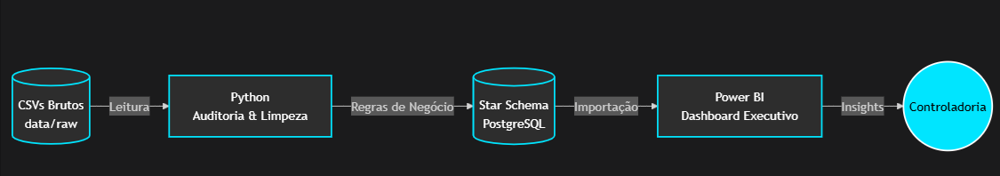
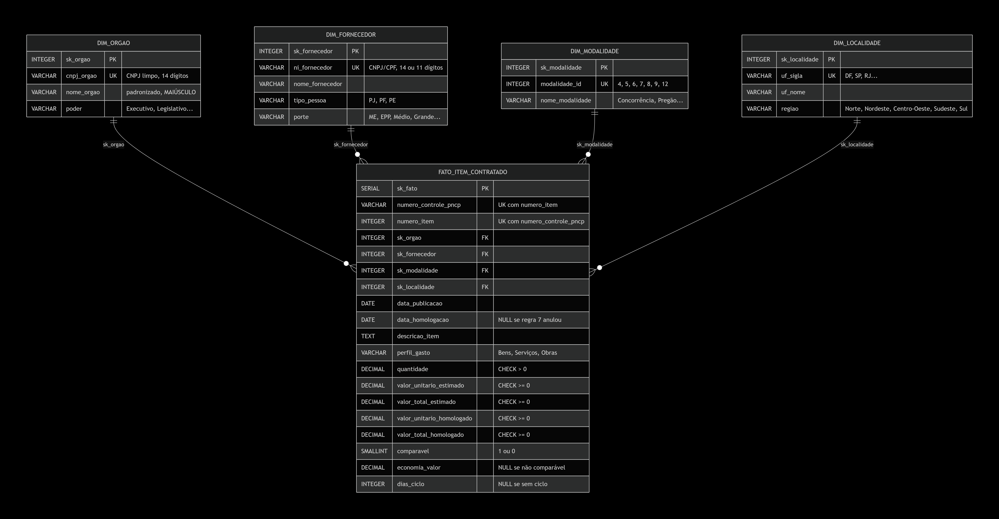
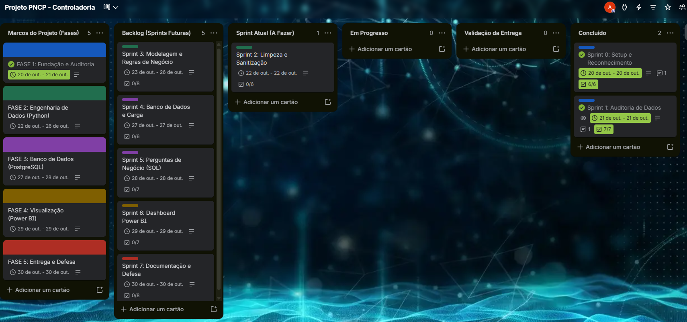
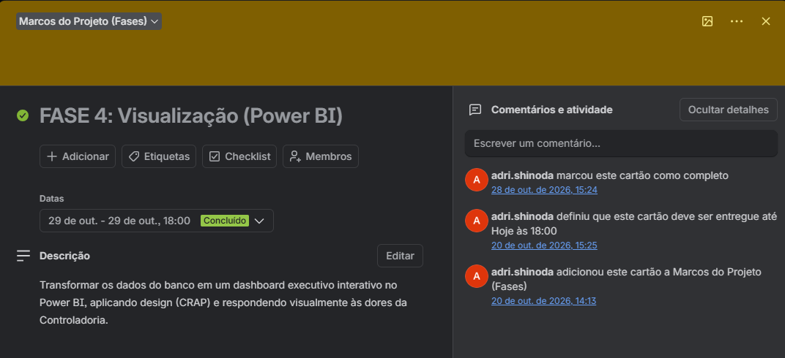
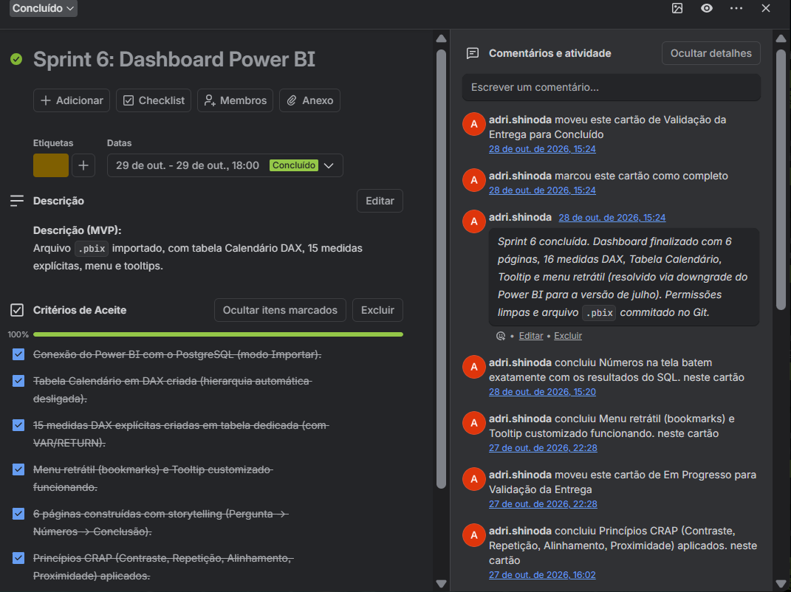
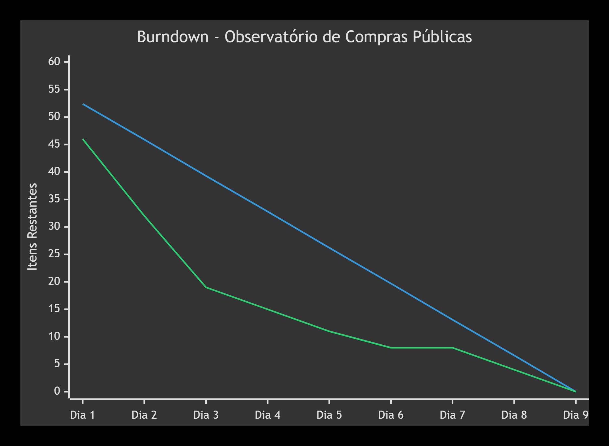

<a id="topo"></a>

# Projeto: Auditoria e Inteligência em Compras Públicas (PNCP)

<div align="center">


</div>

Esteira analítica ponta a ponta (*End-to-End*) para auditoria e inteligência de dados em compras públicas federais. Transforma dados brutos e corrompidos do PNCP (Portal Nacional de Contratações Públicas) em um ambiente analítico confiável, auditável e executivo para a Controladoria, utilizando **Python**, **PostgreSQL** e **Power BI**.

> **Resumo Executivo:** Através da higienização de 6.126 itens homologados (R$ 8,04 bi), o dashboard revelou uma **economia global de 14,46% (R$ 992,86 milhões)**. A análise apontou que Obras consomem 60,8% do orçamento e que o Top 10 fornecedores concentra 41,43% dos gastos.

---

<a id="indice"></a>
## Índice

- [1. Contexto e Problema de Negócio](#1-contexto)
- [2. Arquitetura da Solução e Tecnologias](#2-arquitetura)
  - [2.1. Visão Geral e Diagrama End-to-End](#21-visao-geral)
  - [2.2. Tecnologias Utilizadas](#22-tecnologias)
  - [2.3. Estratégia de Versionamento (Git Workflow)](#23-versionamento)
  - [2.4. Estrutura do Repositório](#24-estrutura)
- [3. Auditoria Inicial e Dicionário de Inconsistências](#3-auditoria)
  - [3.1. Pergunta 1 — Volumetria e duplicidade da chave](#31-volumetria)
  - [3.2. Pergunta 2 — Formatos de dinheiro, data, CNPJ e nulos](#32-formatos)
  - [3.3. Pergunta 3 — Encoding quebrado](#33-encoding)
  - [3.4. Pergunta 4 — Cronologia](#34-cronologia)
  - [3.5. Síntese para a Sprint 2](#35-sintese)
- [4. Decisões Técnicas e Regras de Negócio](#4-decisoes)
  - [4.1. Sanitização em Python (`src/limpeza.py`)](#41-sanitizacao)
  - [4.2. Regras de negócio da Controladoria](#42-regras-negocio)
  - [4.3. Matriz de Rastreabilidade](#43-rastreabilidade)
- [5. Modelagem Dimensional (Star Schema)](#5-modelagem)
  - [5.1. Diagrama](#51-diagrama)
  - [5.2. Visão Geral e Estrutura](#52-estrutura)
  - [5.3. Dicionário de Dados](#53-dicionario)
  - [5.4. Decisões de modelagem](#54-decisoes-modelagem)
- [6. Perguntas de Negócio e Respostas](#6-perguntas)
  - [6.1. Resumo](#61-resumo)
  - [6.2. P1 — Economia global do Poder Público](#62-p1)
  - [6.3. P2 — Concentração e risco de fornecedores](#63-p2)
  - [6.4. P3 — Eficácia por modalidade](#64-p3)
  - [6.5. P4 — Tempo do ciclo de compras](#65-p4)
  - [6.6. P5 — Distribuição regional](#66-p5)
  - [6.7. P6 — Perfil dos gastos](#67-p6)
- [7. Planejamento em Sprints e Lições Aprendidas](#7-sprints)
  - [7.1. Histórico de Sprints](#71-historico)
  - [7.2. Monitoramento de Progresso (Burndown Chart)](#72-burndown)
- [8. Registros de Decisão de Arquitetura (ADRs)](#8-adr)
- [9. Segurança da Informação e LGPD](#9-lgpd)
- [10. Limitações do Estudo](#10-limitacoes)
- [11. Guia de Execução (Como reproduzir)](#11-execucao)
- [12. Melhorias Futuras e Vídeo de Defesa](#12-melhorias)
- [13. Autora](#13-autora)

---

<a id="1-contexto"></a>
## 1. Contexto e Problema de Negócio

### 1.1. O Cenário
Atuando como Analista de Dados em uma consultoria de inteligência governamental, o projeto nasce de uma demanda crítica da **Controladoria**. O órgão identificou problemas nas compras e contratações públicas federais, tais como:
- Indícios de sobrepreço em itens homologados;
- Concentração atípica de contratos em determinados grupos econômicos;
- Morosidade excessiva entre a publicação de editais e a homologação final;
- Baixa adesão competitiva em certas modalidades licitatórias.

### 1.2. O Desafio dos Dados
Os sistemas legados de onde os dados são extraídos não possuem travas rígidas de validação onde há incidência de: identificadores corrompidos, campos monetários preenchidos em texto livre, inconsistências lógicas de cronograma e formatos de data despadronizados. 

Como resultado, a liderança governamental **não confia nos relatórios atuais** gerados a partir desses dados brutos, o que impede a tomada de decisão estratégica e a auditoria contínua.

### 1.3. A Missão do Projeto
O objetivo deste projeto é **liderar o desenvolvimento de uma esteira analítica ponta a ponta (End-to-End)**. A missão é transformar esses dados corrompidos em um ambiente analítico confiável, auditável e executivo, cruzando os dados de cabeçalho das contratações (órgãos, datas, modalidades) com os itens efetivamente licitados.

O recorte temporal abrange a base oficial do ano de 2025, garantindo uma visão ampla e representativa das contratações federais.

[⬆ Voltar ao índice](#indice)

---

<a id="2-arquitetura"></a>
## 2. Arquitetura da Solução e Tecnologias

<a id="21-visao-geral"></a>
### 2.1. Visão Geral e Diagrama End-to-End
O projeto foi desenhado como uma esteira analítica em camadas, onde os dados fluem de forma unidirecional: do estado bruto (CSVs corrompidos) até a camada de visualização executiva (Power BI):



<a id="22-tecnologias"></a>
### 2.2. Tecnologias Utilizadas

A esteira analítica foi construída utilizando ferramentas open-source e líderes de mercado, divididas pelas seguintes camadas:

| Tecnologia | Camada | Função no Projeto |
| :--- | :--- | :--- |
| **Python (pandas)** | Engenharia de Dados | Leitura dos CSVs, auditoria de anomalias, higienização (limpeza de CNPJ, moedas e datas) e aplicação das regras de negócio. |
| **PostgreSQL** | Banco de Dados | Armazenamento da camada analítica no modelo Star Schema (1 Fato + 4 Dimensões), garantindo integridade referencial via constraints (PK, FK, CHECK). |
| **psycopg2** | Integração / Driver | Biblioteca Python utilizada para conectar ao banco de dados e realizar a carga em lote (batch insert) de forma performática e segura. |
| **Power BI** | Visualização de Dados | Construção do dashboard executivo interativo, criação da tabela Calendário e das 15+ medidas em linguagem DAX para o storytelling. |
| **Git / GitHub** | Versionamento | Controle de versão do código utilizando a estratégia de Feature Branches e Pull Requests, além da documentação viva no README. |

<a id="23-versionamento"></a>
### 2.3. Estratégia de Versionamento (Git Workflow)

O projeto adotou **Feature Branching por fase**, com **merge via Pull Request** ao final de cada uma. O objetivo é manter a branch `main` sempre estável, preservar o histórico granular da evolução e garantir a rastreabilidade de todas as entregas.

**Ciclo por fase:**

1. `git checkout -b feat/fase-N-...` a partir da `main` atualizada;
2. Commits granulares na branch de trabalho (`feat:`, `fix:`, `docs:`);
3. Pull Request (PR) descritivo para a `main`, aberto somente após a conclusão do Checklist de Fechamento da fase;
4. **Create a merge commit** (não squash) — preserva os commits originais no histórico da `main`.

**Rollback e Segurança:** Como cada fase vive em uma branch isolada, reverter uma entrega problemática é um processo simples de `git checkout main` seguido da exclusão da branch — a `main` permanece intacta no estado anterior. A granularidade dos commits (não-squash) permite ainda um `git revert` cirúrgico de um único commit, sem desfazer a fase inteira. 

A segurança do repositório é garantida por dois mecanismos: o `.gitignore` bloqueia o arquivo `.env` (garantindo que as credenciais do PostgreSQL nunca entrem no repositório) e o fluxo de PR impede pushes diretos, forçando que todo código passe por validação contra a Prova Real antes do merge. As branches de fase são mantidas após o merge para permitir auditoria retroativa no vídeo de defesa.

<a id="24-estrutura"></a>
### 2.4. Estrutura do Repositório

Para garantir a manutenibilidade e a reprodutibilidade o repositório foi organizado de forma modular:

```text
observatorio-compras-publicas/
├── data/raw/              # CSVs brutos fornecidos pelo professor (imutáveis)
├── docs/img/              # Imagens, diagramas e prints utilizados no README
├── powerbi/               # Arquivo .pbix do dashboard executivo
├── sql/                   # Scripts SQL de banco de dados
│   ├── 01_criar_banco.sql # DDL: Criação do Star Schema e constraints
│   └── 02_perguntas.sql   # DQL: As 6 queries de negócio da Controladoria
├── src/                   # Pipeline Python (ETL)
│   ├── auditoria.py       # Diagnóstico e raio-x dos dados brutos
│   ├── banco.py           # Utilitários de conexão e inserção no PostgreSQL
│   ├── carregar.py        # Orquestrador da carga no banco de dados
│   ├── config.py          # Configurações de caminhos e variáveis de ambiente
│   ├── limpeza.py         # Sanitização (CNPJs, moedas, datas, encodings)
│   └── montar_tabelas.py  # Aplicação das 12 regras de negócio e modelagem
├── .env.example           # Modelo público das variáveis de ambiente
├── .gitignore             # Proteção de arquivos sensíveis (.env, venv)
├── requirements.txt       # Dependências Python do projeto
└── README.md              # Documentação técnica e de negócio
```

[⬆ Voltar ao índice](#indice)

<a id="3-auditoria"></a>
## 3. Auditoria Inicial e Dicionário de Inconsistências

Foi criado o script `src/auditoria.py` faz um raio-x **somente diagnóstico** (não altera os dados): carrega os 3 CSVs como texto (`dtype=str`) para preservar zeros à esquerda e evitar inferência equivocada de tipos. As subseções abaixo respondem, uma a uma, às 4 perguntas da Seção 7.4 do enunciado.

<a id="31-volumetria"></a>
### 3.1. Pergunta 1 — Volumetria e duplicidade da chave

> *"Quantas linhas tem cada arquivo? Há `numero_controle_pncp` repetido em `compras.csv`?"*

**Resposta:**

- **`compras.csv`:** 2.042 linhas × 25 colunas.
- **`itens.csv`:** 7.077 linhas × 14 colunas.
- **`resultados.csv`:** 15.896 linhas × 13 colunas.
- **`numero_controle_pncp` em `compras.csv`:** 2.042 linhas, 2.042 valores distintos → **zero duplicatas**. O grão "1 linha por contratação" está preservado.

**Chave de ligação:** `numero_controle_pncp` (liga `compras` → `itens` → `resultados`). A combinação `numero_controle_pncp` + `numero_item` identifica unicamente cada linha de `itens` e de `resultados`.

Os três números de linhas conferem **exatamente** com o Anexo 8 (Prova Real) do enunciado.

<a id="32-formatos"></a>
### 3.2. Pergunta 2 — Formatos de dinheiro, data, CNPJ e nulos

> *"Que formatos de dinheiro, de data e de CNPJ aparecem? Quais colunas têm N/A, -, 0, vazio?"*

**Resposta:**

- **Dinheiro:** a mesma coluna mistura `R$`, vírgula decimal e ponto decimal (inclusive o padrão invertido `250,782.10`). **Nenhum** valor veio como "só dígitos" — todos têm parte decimal. O formato **predominante é o inglês/ISO** (ponto decimal, 78%), com minoria brasileira (vírgula decimal, 22%).
- **Data:** **8 formatos distintos coexistem** na base — ISO 8601 com `T` (`aaaa-mm-ddThh:mm[:ss]`), ISO puro (`aaaa-mm-dd`), `dd/mm/aaaa`, `dd/mm/aaaa hh:mm`, `dd-mm-aaaa`, `dd.mm.aaaa`, `aaaammdd` e `aaaa/mm/dd`. Por isso, `pd.to_datetime(dayfirst=True)` sozinho **não resolve**: foi implementada a função `parse_data_robusto()` com **16 variações** (cobrindo combinações com e sem hora) para garantir 100% de cobertura.
- **CNPJ/CPF:** há mascarados, puros (14 dígitos), com zero perdido (13 dígitos) e CPF convivendo com CNPJ na mesma coluna.
- **Nulos disfarçados:** aparecem em 6 colunas, com destaque para `categoria_item` (100% `"NÃO SE APLICA"`) e `modo_disputa` (45%).
- **`"0"` em texto:** aparece em 4 colunas (`processo`, `modo_disputa`, `situacao_item`, `porte`) — será tratado como nulo **apenas** nessas colunas.
- **Vazio real (`NaN`):** destacam-se `catalogo_codigo_item` (99,9%), `ordem_classificacao_srp` (75%) e `data_cancelamento` (99,6%, equivalente a 62 cancelados). Há ainda 7 outras colunas com NaN em menor volume (detalhadas na Tabela 3.2.2).

**Detalhamento:**

#### 3.2.1. Nulos disfarçados (`N/A`, `NULL`, `-`, `SEM INFORMAÇÃO`, `NÃO SE APLICA`)

| Arquivo | Coluna | Ocorrências | Observação |
| :--- | :--- | ---: | :--- |
| `compras.csv` | `processo` | 32 | campo opcional |
| `compras.csv` | `modo_disputa` | 925 | **45% da base** |
| `itens.csv` | `categoria_item` | 7.077 | **100%** — coluna inútil |
| `itens.csv` | `situacao_item` | 79 | campo opcional |
| `itens.csv` | `criterio_julgamento` | 1.883 | 26,6% |
| `resultados.csv` | `porte` | 172 | campo opcional |

> **Decisão de projeto:** `"0"` **não** foi classificado como nulo nesta tabela. O enunciado alerta que `"0"` só é nulo em **campos de texto**; em quantidades e valores é número. A separação por tipo acontece na Sprint 2.

#### 3.2.2. Zeros e vazios

| Arquivo | Coluna | `"0"` | Vazios (`""`) | NaN real | Observação |
| :--- | :--- | ---: | ---: | ---: | :--- |
| `compras.csv` | `processo` | 12 | 0 | 28 | — |
| `compras.csv` | `modo_disputa` | 7 | 0 | 26 | — |
| `compras.csv` | `data_abertura_proposta` | 0 | 0 | 617 | 30% sem data |
| `compras.csv` | `data_encerramento_proposta` | 0 | 0 | 617 | 30% sem data |
| `itens.csv` | `unidade_medida` | 0 | 0 | 9 | — |
| `itens.csv` | `situacao_item` | 25 | 0 | 92 | — |
| `itens.csv` | `catalogo_codigo_item` | 0 | 0 | 7.068 | **99,9% vazio** — descartar |
| `resultados.csv` | `ordem_classificacao_srp` | 0 | 0 | 11.976 | **75% vazio** — esperado em Credenciamento |
| `resultados.csv` | `porte` | 57 | 0 | 196 | — |
| `resultados.csv` | `data_cancelamento` | 0 | 0 | 15.834 | **só 62 cancelados** (0,4%) |

#### 3.2.3. Formatos monetários

A base mistura **prefixo `R$`**, **vírgula decimal** e **ponto decimal** na **mesma coluna**. Isso confirma a regra do enunciado: *"ponto ou vírgula sozinho é sempre decimal; só o separador repetido (1.234.567) é milhar; quando aparecem os dois símbolos, o último é o decimal"*.

**Tabela A — Presença do prefixo `R$`**

| Arquivo | Coluna | Com `R$` | Sem `R$` (implícito) |
| :--- | :--- | ---: | ---: |
| `compras.csv` | `valor_total_estimado` | 344 | 1.698 |
| `compras.csv` | `valor_total_homologado` | 346 | 1.696 |
| `itens.csv` | `valor_unitario_estimado` | 1.188 | 5.889 |
| `itens.csv` | `valor_total_estimado` | 1.171 | 5.906 |
| `resultados.csv` | `valor_unitario_homologado` | 2.650 | 13.246 |
| `resultados.csv` | `valor_total_homologado` | 2.647 | 13.249 |

**Tabela B — Separador decimal (última posição)**

> Esta tabela é **mutuamente exclusiva** e **soma exatamente o total** de cada coluna — a classificação está 100% completa.

| Arquivo | Coluna | Vírgula decimal (BR) | Ponto decimal (EN/ISO) | Total | Status |
| :--- | :--- | ---: | ---: | ---: | :---: |
| `compras.csv` | `valor_total_estimado` | 445 | 1.597 | 2.042 | Conforme |
| `compras.csv` | `valor_total_homologado` | 442 | 1.600 | 2.042 | Conforme |
| `itens.csv` | `valor_unitario_estimado` | 1.489 | 5.588 | 7.077 | Conforme |
| `itens.csv` | `valor_total_estimado` | 1.462 | 5.615 | 7.077 | Conforme |
| `resultados.csv` | `valor_unitario_homologado` | 3.356 | 12.540 | 15.896 | Conforme |
| `resultados.csv` | `valor_total_homologado` | 3.315 | 12.581 | 15.896 | Conforme |

> **Nota:** as duas tabelas **não podem ser somadas** entre si. Os valores com `R$` (Tabela A) também aparecem em uma das categorias de decimal (Tabela B). Ou seja, `"R$ 419.848,81"` conta em **"com R$"** e em **"vírgula decimal"** ao mesmo tempo.

**Exemplos que coexistem na mesma coluna:**

- `"20307804.45"` (ponto decimal, sem prefixo)
- `"R$ 419.848,81"` (ponto milhar + vírgula decimal + prefixo)
- `"250,782.10"` (vírgula milhar + ponto decimal — **inverso** do padrão brasileiro)
- `"19.290.383,46"` (formato brasileiro completo)
- `"900.0"`, `"151826.0"` (ponto decimal, apenas 1 casa)

**Achados para a Sprint 2:**

- O formato **predominante é o inglês/ISO** (ponto decimal): **78%** dos valores; o brasileiro (vírgula) representa **22%**.
- **Nenhum** valor aparece como "só dígitos" (0 ocorrências) e **nenhum** aparece como negativo entre parênteses (0 ocorrências). Todo valor monetário termina em `,XX` ou `.XX`.
- A regra do enunciado ("o último símbolo é o decimal") resolve 100% dos casos sem ambiguidade.

#### 3.2.4. Formatos de data

| Arquivo | Coluna | `dd/mm/aaaa` | `dd/mm/aaaa hh:mm` | ISO | `dd-mm-aaaa` | Outros |
| :--- | :--- | ---: | ---: | ---: | ---: | ---: |
| `compras.csv` | `data_publicacao` | 117 | 126 | 1.319 | 138 | 342 |
| `compras.csv` | `data_abertura_proposta` | 78 | 86 | 912 | 85 | 264 |
| `compras.csv` | `data_encerramento_proposta` | 78 | 101 | 926 | 75 | 245 |
| `resultados.csv` | `data_resultado` | 929 | 934 | 10.301 | 912 | 2.820 |

> **Nota:** a coluna "ISO" representa dois formatos distintos: `aaaa-mm-ddThh:mm[:ss]` (ISO **com** `T`) nas datas de `compras.csv` e `aaaa-mm-dd` (ISO **puro**, sem hora) em `data_resultado`. Nenhum arquivo mistura os dois — cada campo tem seu formato dominante.

**Formatos em "Outros":** `dd.mm.aaaa` (`02.01.2025`), `aaaammdd` (`20250103`), `aaaa/mm/dd` (`2025/01/02`).

> **Consequência:** a conversão exige **parser multi-formato** — implementado como `parse_data_robusto()` em `src/auditoria.py` e reaproveitado na Sprint 2.

#### 3.2.5. Formatos de CNPJ/CPF

| Arquivo | Coluna | Mascarado | 14 díg. | 13 díg. (zero perdido) | CPF mascarado | CPF 11 díg. |
| :--- | :--- | ---: | ---: | ---: | ---: | ---: |
| `compras.csv` | `cnpj_orgao` | 176 | 1.789 | **10** | — | **3** |
| `resultados.csv` | `ni_fornecedor` | 1.239 | 9.911 | **175** | 392 | 3.981 |

**Achados críticos:**

- **175 CNPJs perderam o zero à esquerda** em `ni_fornecedor` (13 dígitos em vez de 14) — o enunciado previu isso.
- **3 valores em `cnpj_orgao` são CPF (11 dígitos)** — inconsistência grave: `cnpj_orgao` deveria conter apenas CNPJ de órgão público. Esses 3 registros precisarão de atenção manual.
- `ni_fornecedor` tem **3.981 CPFs puros** e **392 CPFs mascarados** — a base mistura pessoa física e jurídica.

<a id="33-encoding"></a>
### 3.3. Pergunta 3 — Encoding quebrado

> *"Existe texto com acento quebrado (ç, ã)? Em quais colunas?"*

**Resposta:** **Sim.** O encoding quebrado aparece em **5 colunas de texto livre** — `objeto_compra`, `municipio`, `nome_unidade`, `descricao` e `nome_fornecedor`. Não há encoding quebrado em colunas de código, data ou valor.

**Detalhamento:**

| Arquivo | Coluna | Padrões quebrados detectados | Total aprox. |
| :--- | :--- | :--- | ---: |
| `compras.csv` | `objeto_compra` | `ç`, `ã`, `é`, `á`, `ó`, `ú` | ~115 |
| `compras.csv` | `municipio` | `ç`, `ã`, `é`, `ó` | ~23 |
| `compras.csv` | `nome_unidade` | `ç`, `ã`, `é`, `ó` | ~4 |
| `itens.csv` | `descricao` | `ç`, `ã`, `é`, `á`, `ó`, `ú` | ~216 |
| `resultados.csv` | `nome_fornecedor` | `é` | ~1 |

> **"Total aproximado"** porque uma mesma célula pode conter mais de um padrão (ex: `"Ação"` conta em `ç` e em `ã`).

> **Nota técnica:** o caractere `"Ã"` **isolado** foi removido dos padrões de detecção porque gera falso positivo — palavras legítimas como "SÃO", "AÇÃO" e "MUNICÍPIO" contêm `Ã` como grafia correta. O indicador real de dupla codificação é `Ã` **seguido de outro caractere** (`ç`, `ã`, `é` etc.).

<a id="34-cronologia"></a>
### 3.4. Pergunta 4 — Cronologia: `data_resultado` vs. `data_publicacao`

> *"Existe `data_resultado` anterior a `data_publicacao`?"*

**Resposta:** **Sim.** Há **1.056 casos (6,64%)** de `data_resultado` anterior à `data_publicacao`, entre os 15.896 resultados da base. Esses registros serão anulados na Sprint 3 (regra 7 do enunciado), mantendo o item na Fato mas sem ciclo.

**Detalhamento:**

- Total de resultados: **15.896**;
- Resultados com ambas as datas válidas (parser multi-formato): **15.896 (100,0%)**;
- Datas invertidas (`data_resultado` < `data_publicacao`): **1.056 (6,64%)**.

**Parser utilizado:** `parse_data_robusto()` tenta sequencialmente **16 variações** (8 formatos-base × combinações com/sem hora e com/sem segundos), até esgotar. Os **8 formatos-base** observados na base são: ISO 8601 com `T`, ISO puro, `dd/mm/aaaa`, `dd/mm/aaaa hh:mm`, `dd-mm-aaaa`, `dd.mm.aaaa`, `aaaammdd` e `aaaa/mm/dd` — todos cobertos pelo parser, o que garante **100% de cobertura** (15.896 de 15.896).

**Impacto previsto na Sprint 3:** os 1.056 resultados com datas invertidas não correspondem, necessariamente, a 1.056 itens sem ciclo. Após a **regra 2** (escolher o vencedor por item), apenas os itens cujo **vencedor** tem `data_resultado` invertida perderão a data de homologação.

<a id="35-sintese"></a>
### 3.5. Síntese para a Sprint 2

| Inconsistência | Colunas afetadas | Estratégia prevista |
| :--- | :--- | :--- |
| **CNPJ/CPF mascarado** | `cnpj_orgao`, `ni_fornecedor` | Remover `.`, `/`, `-`; manter como `str`; devolver zero à esquerda até 14 dígitos |
| **CNPJ com zero perdido** | `cnpj_orgao` (10), `ni_fornecedor` (175) | `zfill(14)` após limpeza |
| **CPF em campo de órgão** | `cnpj_orgao` (3) | Marcar e documentar; tratar como "não informado" na Fase 3 |
| **Moeda: `R$`, vírgula, ponto** | 6 colunas monetárias | Normalizar pela regra do enunciado (último símbolo = decimal); validar que `vírgula + ponto = total` |
| **Datas em 8 formatos** | 4 colunas | `parse_data_robusto()` (já implementado) |
| **Nulos disfarçados** | 6 colunas | Substituir por `NaN`/`None` **após** classificar tipo |
| **`"0"` em campo de texto** | `processo`, `modo_disputa`, `situacao_item`, `porte` | Tratar como nulo **apenas** nessas colunas |
| **Encoding quebrado** | 5 colunas de texto | Reprocessar como `latin-1` → `utf-8` |
| **`catalogo_codigo_item` vazio** | `itens.csv` | Descartar (99,9% vazio) |
| **Datas invertidas** | `resultados.data_resultado` vs. `compras.data_publicacao` | Anular `data_homologacao` e `dias_ciclo` (regra 7) |

[⬆ Voltar ao índice](#indice)

<a id="4-decisoes"></a>
## 4. Decisões Técnicas e Regras de Negócio

<a id="41-sanitizacao"></a>
### 4.1. Sanitização em Python (`src/limpeza.py`)

O módulo `src/limpeza.py` foi concluído com **54/54 testes passando**. Cada função resolve uma classe de inconsistência identificada na Seção 3.

#### 4.1.1. Limpeza de texto

| Função | Inconsistência tratada | Decisão técnica |
| :--- | :--- | :--- |
| `remover_invisiveis()` | Caracteres zero-width (`\u200b`, `\u200c`, `\ufeff`) de sistemas antigos | Substituição literal por string vazia |
| `consertar_acento()` | Dupla codificação UTF-8→Latin-1 (`Aquisição` → `Aquisição`) | `encode("latin-1").decode("utf-8")` dentro de `try/except` — se falhar, devolve o texto como estava |
| `tirar_espacos()` | Espaços repetidos, tabs, quebras de linha, non-breaking space (`\xa0`) | `" ".join(texto.split())` — o `split()` sem argumento cobre **todos** os whitespaces |
| `eh_nulo()` | Nulos disfarçados (`N/A`, `-`, `NULL`, `"0"` em texto) | Retorna `True` se o texto (em maiúsculas) está no set `NULOS` |
| `limpar_texto()` | Pipeline de todas as anteriores | Remover invisíveis → corrigir acento → tirar espaços → checar se virou nulo |
| `padronizar_nome()` | Nomes de órgão/fornecedor escritos de formas diferentes | `upper()` + troca de `-` por `" - "` (o `tirar_espacos` absorve duplicados) |

#### 4.1.2. Ambiguidade do `"0"` — decisão de design

A Seção 3 registrou que `"0"` **não foi tratado como nulo na auditoria**, aguardando separação por tipo (texto vs. numérico). A `limpeza.py` resolve a ambiguidade através do parâmetro **`zero_eh_nulo`**:

- **`zero_eh_nulo=True`** (padrão, para campos de texto) — `"0"` é nulo disfarçado.
- **`zero_eh_nulo=False`** (para campos numéricos) — `"0"` é o valor `0.0`.

A função `converter_numero()` chama `limpar_texto(texto, zero_eh_nulo=False)` explicitamente. Os campos `processo`, `modo_disputa`, `situacao_item` e `porte` (identificados na Seção 3) usarão o padrão `True`.

#### 4.1.3. Documentos (CNPJ/CPF)

| Função | Decisão técnica |
| :--- | :--- |
| `limpar_documento()` | Extrai apenas dígitos (`c.isdigit()`), descarta máscaras. Usa `zfill(tamanho)` para restaurar zeros à esquerda perdidos. Tamanho = 14 (PJ), 11 (PF) ou inferido pelo comprimento. **Pessoa estrangeira (PE)** é preservada como texto em maiúsculas. Documentos com dígitos a mais são rejeitados (`None`). |

**Cobertura contra a Seção 3:**
- 175 CNPJs com zero à esquerda em `ni_fornecedor` → `zfill(14)` recupera;
- 10 CNPJs com zero perdido em `cnpj_orgao` → idem;
- 3.981 CPFs puros + 392 CPFs mascarados → extração limpa;
- 3 CPFs em `cnpj_orgao` → serão rejeitados pela função (`tipo_pessoa="PJ"` espera 14 dígitos). Decisão de destino final na Sprint 3.

#### 4.1.4. Dinheiro e números

| Função | Decisão técnica |
| :--- | :--- |
| `converter_numero()` | Implementa a regra do enunciado: **ponto ou vírgula sozinho é decimal; repetido é milhar; quando os dois aparecem, o último é o decimal**. Negativos detectados por `(`, `-` no início ou `-` no final. Usa `zero_eh_nulo=False` (aqui `"0"` é valor, não nulo). |

Todos os formatos monetários identificados na Seção 3 são convertidos corretamente (`R$ 419.848,81`, `19.290.383,46`, `250,782.10`, `900.0`, `1.234.567`, `(1.500,00)`, `1.500,00-`).

#### 4.1.5. Datas

| Função | Decisão técnica |
| :--- | :--- |
| `converter_data()` | Corta o texto em 10 caracteres (`[:10]`) para descartar a hora. Testa **6 formatos** em sequência. Retorna `datetime.date` (não `datetime`) — alinhado com o tipo `DATE` do PostgreSQL (Sprint 4). Valida faixa de ano **2000–2030** — datas fora disso (ex: `0001-01-01`) são rejeitadas como impossíveis. |

Os 8 formatos detectados na auditoria descrita na Seção 3 são cobertos pelos 6 formatos-base (combinados com/sem hora). Datas invertidas (1.056 casos) serão tratadas na Sprint 3 pela **regra 7** do enunciado.

#### 4.1.6. Limitações conhecidas

- **`padronizar_nome()`** insere espaço ao redor de qualquer `-`. Resolve `"Pregão-Eletrônico"` → `"PREGÃO - ELETRÔNICO"`, mas alteraria códigos com hífen interno (ex: `"ABC-123"` → `"ABC - 123"`). Para o escopo atual (nomes de órgão/fornecedor), é aceitável.
- **`remover_invisiveis()`** usa caracteres zero-width literais no código-fonte (invisíveis no editor). Alternativa mais robusta: usar `\u200b` explícito como escape Unicode. Não impacta o resultado; é questão de manutenibilidade.

<a id="42-regras-negocio"></a>
### 4.2. Regras de negócio da Controladoria (`src/montar_tabelas.py`)

#### 4.2.1. Decisões herdadas da auditoria e da limpeza

| Coluna | Achado (Seção 3) | Decisão na Sprint 3 |
| :--- | :--- | :--- |
| `categoria_item` | 100% `"NÃO SE APLICA"` | **Descartada** — não vai para nenhuma tabela |
| `catalogo_codigo_item` | 99,9% vazio (7.068 de 7.077) | **Descartada** |
| `ordem_classificacao_srp` | 75% NaN (11.976) | **NaN → 1** (regra 2 do enunciado: "vazio conta como 1") |
| `data_cancelamento` | 99,6% vazio (15.834 NaN) | **Lida como booleana** — preenchido = cancelado, independente do conteúdo |
| `cnpj_orgao` com CPF | 3 registros com 11 dígitos | **Rejeitados** por `limpar_documento(tipo_pessoa="PJ")` → `sk_orgao = -1` |
| Colunas monetárias | 6 colunas com formatos mistos | `converter_numero()` com `zero_eh_nulo=False` |
| Parser de data | 8 formatos-base coexistem | `converter_data()` cobre os 8 (6 formatos-base + corte `[:10]`) |

#### 4.2.2. Colunas numéricas com `zero_eh_nulo=False`

O parâmetro `zero_eh_nulo` (definido em 4.1.2) deve ser `False` para as seguintes colunas (onde `0` é valor legítimo, não nulo):

- `itens.csv`: `quantidade`, `valor_unitario_estimado`, `valor_total_estimado`
- `resultados.csv`: `quantidade_homologada`, `valor_unitario_homologado`, `valor_total_homologado`, `ordem_classificacao_srp`, `sequencial_resultado`

Todas as demais colunas usam `limpar_texto()` com o padrão `zero_eh_nulo=True`.

#### 4.2.3. Duplicação intencional de parser de data

Existem duas implementações de parser no projeto:

| Parser | Onde | Propósito | Estratégia |
| :--- | :--- | :--- | :--- |
| `parse_data_robusto()` | `auditoria.py` | **Diagnóstico** (Sprint 1) | 16 variações, sem corte — maximiza detecção |
| `converter_data()` | `limpeza.py` | **Operação** (Sprint 2 em diante) | 6 formatos-base + `[:10]` para descartar hora |

Ambas cobrem os 8 formatos-base identificados em 3.2.4. A duplicação é **intencional**: o diagnóstico exige robustez máxima; a operação exige clareza e velocidade.

#### 4.2.4. Colunas onde `padronizar_nome()` será aplicado

- `compras.razao_social_orgao` → `dim_orgao.nome_orgao`
- `resultados.nome_fornecedor` → `dim_fornecedor.nome_fornecedor`
- `itens.descricao` → vai para `fato_item_contratado.descricao_item` **sem** uppercase (preserva case original para legibilidade em auditoria)
- `compras.objeto_compra` → usado apenas como auxiliar da regra 8 (perfil do gasto), **sem** uppercase

#### 4.2.5. Implementação das 12 regras de negócio — resultado

O script `src/montar_tabelas.py` foi implementado com sucesso: **todos os 10 números da Prova Real batem** com o Anexo 8 do enunciado.

| Métrica | Obtido | Prova Real | Status |
| :--- | ---: | ---: | :---: |
| Itens na fato | 6.126 | 6.126 | Conforme |
| Contratações distintas | 1.962 | 1.962 | Conforme |
| Fornecedores | 2.652 | 2.652 | Conforme |
| Órgãos (CNPJ) | 363 | 363 | Conforme |
| Volume homologado | R$ 8.044.498.805,74 | R$ 8.044.498.805,74 | Conforme |
| Itens comparáveis | 5.457 | 5.457 | Conforme |
| Economia | 14,46% | 14,46% | Conforme |
| Ciclo médio / máximo | 48,1 / 611 | 48,1 / 611 | Conforme |
| Itens sem ciclo | 230 | 230 | Conforme |
| Perfil do gasto | Obras 60,8% / Serviços 36,6% / Bens 2,6% | idem | Conforme |

> **A Matemática do Funil (Como chegamos aos 6.126 itens):**
> Para provar que o número não foi copiado, e sim calculado, o funil de retenção da Fato funciona assim:
> 1. **Total de itens brutos (`itens.csv`):** 7.077 itens.
> 2. **Regra 3 (Só itens com resultado):** O `merge` descarta 852 itens que não têm fornecedor vencedor. (7.077 - 852 = **6.225 itens**).
> 3. **Regra 4 (Itens rejeitados):** 99 itens com dados impossíveis são removidos. (6.225 - 99 = **6.126 itens**).
> 
> O número final bate exatamente com o Anexo 8 porque aplicamos as regras na ordem correta, sem pular etapas.


**Regras implementadas (referência: Seção 4.2 do enunciado):**

| Regra | Implementação |
| :--- | :--- |
| 1. Grão da fato | `numero_controle_pncp` + `numero_item` (garantido na Etapa 9 pelo `drop_duplicates`) |
| 2. Um vencedor por item | Filtrar cancelados → ordenar por `ordem` e `sequencial` → `drop_duplicates` mantém o 1º |
| 3. Só itens com resultado | `merge(how="inner")` — 6.225 itens com resultado (852 sem resultado ficaram fora) |
| 4. Itens rejeitados | 99 rejeitados (quantidade ≤ 0, estimado/homologado ≤ 0, sigiloso, valor < R$ 1, hom > 1000x est, > R$ 1 tri) |
| 5. Valores | `valor_total = valor_unitario × quantidade` (usando quantidade homologada quando > 0) |
| 6. Comparável e economia | `modalidade_id != 12` E razão entre 0,1 e 10 → 5.457 comparáveis; economia só onde comparável |
| 7. Cronologia | Homologação anterior à publicação → `data_homologacao = None` (230 itens sem ciclo) |
| 8. Perfil do gasto | Regex `\b(OBRAS?\|CONSTRUÇÃO\|REFORMA\|ENGENHARIA)\b` sobre `descricao + objeto_compra`; prioridade para Obras |
| 9. Modalidade | Padronização via dicionário `MODALIDADES[id]` |
| 10. Órgão | `limpar_documento(v, "PJ")` + `padronizar_nome` (363 unidades compradoras) |
| 11. Região | `uf_sigla → REGIAO` (dicionário do Anexo 7.6) |
| 12. Separadores numéricos | `converter_numero()` (Sprint 2) — regra do "último símbolo = decimal" |

> **Nota técnica (Regra 2 — desempate):** O campo `sequencial_resultado` é lido como **número inteiro**, não como texto. Isso garante que o sequencial `2` venha antes do `10` no desempate (se fosse string, `"10"` viria antes de `"2"`). Essa decisão é o que permite bater a Prova Real em Credenciamento, onde todos os itens chegam com `ordem_classificacao_srp` vazia.

**Itens rejeitados — critérios da regra 4:**

Foram rejeitados **99 itens** pelos 7 critérios da regra 4 do enunciado. Cada item foi classificado pelo **primeiro critério que disparou** a rejeição (se um item viola mais de um, conta apenas o primeiro):

| # | Critério de rejeição |
| :---: | :--- |
| 1 | Quantidade vazia ou ≤ 0 |
| 2 | Valor unitário estimado ausente ou ≤ 0 |
| 3 | Valor unitário homologado ausente ou ≤ 0 |
| 4 | Orçamento sigiloso (`sigiloso = True`) |
| 5 | Valor total estimado menor que R$ 1 |
| 6 | Valor total homologado mais de 1.000x o valor total estimado |
| 7 | Valor total (estimado ou homologado) acima de R$ 1 trilhão — limite definido para não estourar o tipo `DECIMAL(18,2)` do PostgreSQL na Sprint 4 |

> **Distinção importante (Regra 3 × Regra 4):** os **852 itens sem resultado** são descartados pela **regra 3** (merge `inner`) e **não contam como rejeitados** pela Prova Real. A Prova Real confere apenas os **99 itens rejeitados** pela **regra 4**. São dois funis distintos: os 852 saem **antes** (por não terem resultado homologado); os 99 saem **depois** (por terem dados impossíveis, mesmo tendo resultado). Somar os dois (951) seria um erro conceitual.

Os itens rejeitados **não são carregados na tabela Fato** — a verificação é feita pelo total (99, conforme Anexo 8); são apenas contabilizados.

**Aprendizado:** a Prova Real foi batida na **primeira execução** após corrigir 1 erro de sintaxe (duplicação no `dias_ciclo`). A estratégia de implementar as 12 regras em ordem de dependência (limpeza → vencedor → merge → valores → rejeição → comparabilidade → cronologia → perfil → dimensões) evitou retrabalho.

<a id="43-rastreabilidade"></a>
### 4.3. Matriz de Rastreabilidade: Inconsistência vs. Tratamento

Para garantir que os problemas diagnosticados na Seção 3 foram tratados, a tabela abaixo cruza os achados com as soluções aplicadas:

| Inconsistência Diagnosticada (Seção 3) | Tratamento Aplicado (Seção 4) | Status |
| :--- | :--- | :---: |
| CNPJ com máscara ou zero perdido | Função `limpar_documento()` com `zfill(14)` | Tratado |
| 3 CPFs na coluna `cnpj_orgao` | Rejeitados na limpeza por regra de tipo de pessoa | Tratado |
| Moedas mistas (R$, vírgula, ponto) | Função `converter_numero()` (regra do último separador) | Tratado |
| Datas em 8 formatos diferentes | Função `converter_data()` com parser multi-formato | Tratado |
| Acentos quebrados (encoding) | Função `consertar_acento()` via encode/decode | Tratado |
| Nulos disfarçados (N/A, 0 em texto) | Função `eh_nulo()` e tratamento por contexto | Tratado |
| `catalogo_codigo_item` 99,9% vazio | Coluna descartada da modelagem | Tratado |
| `categoria_item` 100% nula | Coluna descartada da modelagem | Tratado |
| Datas invertidas (homologação < publicação) | Regra 7: anulação da data de homologação | Tratado |

[⬆ Voltar ao índice](#indice)

<a id="5-modelagem"></a>
## 5. Modelagem Dimensional (Star Schema)

A camada analítica segue o modelo **Star Schema** (1 tabela Fato + 4 Dimensões), implementado no PostgreSQL pela Sprint 4. 

<a id="51-diagrama"></a>
### 5.1. Diagrama

A tabela Fato centraliza o grão de negócio (uma linha por item de contratação), enquanto as 4 Dimensões ao redor respondem às perguntas 'Quem comprou?', 'Quem vendeu?', 'Como?' e 'Onde?', conforme ilustração:



Essa arquitetura elimina a redundância de dados e garante alta performance nas consultas de agregação (OLAP).

<a id="52-estrutura"></a>
### 5.2. Visão Geral e Estrutura

| Tabela | Papel | Linhas | Chave natural (UNIQUE) | Chave substituta (PK) |
| :--- | :--- | ---: | :--- | :--- |
| `fato_item_contratado` | **FATO** — o que foi comprado | 6.126 | `numero_controle_pncp` + `numero_item` | `sk_fato` (SERIAL) |
| `dim_orgao` | Quem comprou | 363 | `cnpj_orgao` | `sk_orgao` |
| `dim_fornecedor` | Quem vendeu | 2.652 | `ni_fornecedor` | `sk_fornecedor` |
| `dim_modalidade` | Como comprou | 7 | `modalidade_id` | `sk_modalidade` |
| `dim_localidade` | Onde | 27 | `uf_sigla` | `sk_localidade` |

**Entendimento das Dimensões:**
- **`dim_orgao`:** Representa a unidade compradora. O grão é o CNPJ, pois o mesmo órgão pode ter várias unidades.
- **`dim_fornecedor`:** Representa o vendedor (CNPJ/CPF). A chave natural é o `ni_fornecedor` já limpo.
- **`dim_modalidade`:** Representa o tipo de licitação (Pregão, Dispensa, etc.).
- **`dim_localidade`:** Representa o local da compra (UF e Região).

<a id="53-dicionario"></a>
### 5.3. Dicionário de Dados

Abaixo estão os metadados das tabelas construídas no PostgreSQL e importadas para o Power BI.

#### Tabela Fato: `fato_item_contratado`
| Coluna | Tipo | Descrição |
| :--- | :--- | :--- |
| `sk_fato` | SERIAL (PK) | Chave substituta auto-gerada para o grão do item. |
| `numero_controle_pncp` | VARCHAR | Identificador da contratação no PNCP (chave natural). |
| `numero_item` | INTEGER | Identificador do item dentro da contratação (chave natural). |
| `sk_orgao` | INTEGER (FK) | Chave estrangeira para a dimensão de órgãos. |
| `sk_fornecedor` | INTEGER (FK) | Chave estrangeira para a dimensão de fornecedores. |
| `sk_modalidade` | INTEGER (FK) | Chave estrangeira para a dimensão de modalidades. |
| `sk_localidade` | INTEGER (FK) | Chave estrangeira para a dimensão de localidades. |
| `data_publicacao` | DATE | Data de publicação do edital. |
| `data_homologacao` | DATE | Data de homologação (nula se a regra 7 anulou). |
| `descricao_item` | TEXT | Descrição do item licitado. |
| `perfil_gasto` | VARCHAR | Classificação (Bens, Serviços, Obras e engenharia). |
| `quantidade` | DECIMAL | Quantidade efetivamente comprada. |
| `valor_unitario_estimado` | DECIMAL | Valor unitário previsto pela Controladoria. |
| `valor_total_estimado` | DECIMAL | Valor unitário estimado × quantidade. |
| `valor_unitario_homologado` | DECIMAL | Valor unitário efetivamente pago. |
| `valor_total_homologado` | DECIMAL | Valor unitário homologado × quantidade. |
| `comparavel` | SMALLINT | Flag (1 ou 0) indicando se o item entra na economia. |
| `economia_valor` | DECIMAL | Diferença entre estimado e homologado (se comparável). |
| `dias_ciclo` | INTEGER | Dias entre a publicação e a homologação (nulo se sem ciclo). |

#### Tabela Dimensão: `dim_orgao`
| Coluna | Tipo | Descrição |
| :--- | :--- | :--- |
| `sk_orgao` | INTEGER (PK) | Chave substituta. |
| `cnpj_orgao` | VARCHAR | CNPJ da unidade compradora (limpo com 14 dígitos). |
| `nome_orgao` | VARCHAR | Nome padronizado do órgão (em maiúsculas). |
| `poder` | VARCHAR | Poder do órgão, por extenso, a partir do `poder_id`: E = Executivo, L = Legislativo, J = Judiciário, N = Não informado. *(Nota: a amostra fornecida não possui registros "N"; todos os 363 órgãos foram mapeados em E, L ou J).* |

#### Tabela Dimensão: `dim_fornecedor`
| Coluna | Tipo | Descrição |
| :--- | :--- | :--- |
| `sk_fornecedor` | INTEGER (PK) | Chave substituta. |
| `ni_fornecedor` | VARCHAR | CNPJ ou CPF do fornecedor (limpo com zeros à esquerda). |
| `nome_fornecedor` | VARCHAR | Nome ou razão social do fornecedor. |
| `tipo_pessoa` | VARCHAR | Classificação (PJ, PF ou PE - Pessoa Estrangeira). |
| `porte` | VARCHAR | Porte da empresa (MEI, EPP, Médio, Grande, etc.). |

#### Tabela Dimensão: `dim_modalidade`
| Coluna | Tipo | Descrição |
| :--- | :--- | :--- |
| `sk_modalidade` | INTEGER (PK) | Chave substituta. |
| `modalidade_id` | INTEGER | Código da modalidade (ex: 6 para Pregão Eletrônico). |
| `nome_modalidade` | VARCHAR | Nome padronizado da modalidade. |

#### Tabela Dimensão: `dim_localidade`
| Coluna | Tipo | Descrição |
| :--- | :--- | :--- |
| `sk_localidade` | INTEGER (PK) | Chave substituta. |
| `uf_sigla` | VARCHAR | Sigla da Unidade Federativa (ex: SP, DF). |
| `uf_nome` | VARCHAR | Nome do estado por extenso. |
| `regiao` | VARCHAR | Região geográfica (Norte, Nordeste, Centro-Oeste, Sudeste, Sul). |

> **Nota sobre a Tabela Calendário:** A dimensão de tempo (`Calendario`) não existe no PostgreSQL. Ela foi criada diretamente no Power BI via DAX (`CALENDARAUTO`), contendo colunas como `Date`, `Ano`, `Mês Número`, `Mês Nome`, `Ano-Mês` e `Trimestre`.

<a id="54-decisoes-modelagem"></a>
### 5.4. Decisões de modelagem

- **Surrogate keys (`sk_*`):** chaves substitutas inteiras, geradas em ordem crescente no `montar_tabelas.py`. Isolam a Fato das chaves naturais (CNPJ, sigla de UF), que podem mudar de formato;
- **Fato no grão do item:** 1 linha por `numero_controle_pncp` + `numero_item` (constraint `UNIQUE` composta);
- **Integridade referencial:** 4 FKs da Fato apontam para as 4 Dimensões, todas `NOT NULL`. A Prova Real confirmou que **não há FK órfã** — a linha `-1` ("Não informado") **não foi necessária**;
- **Tipos de dados:**
  - `DECIMAL(18,2)` para valores monetários totais
  - `DECIMAL(18,4)` para preços unitários e quantidades
  - `DATE` para datas
  - `SMALLINT` para a flag `comparavel` (0 ou 1)
- **CHECKs de integridade:** `quantidade > 0`; todos os valores `>= 0`; `comparavel IN (0, 1)`.
- **Campos vazios:** `data_homologacao`, `economia_valor` e `dias_ciclo` são `NULL` quando a regra de negócio anula o dado (230 itens sem ciclo, itens não comparáveis);
- **Tempo no Power BI:** a dimensão Calendário **não é tabela do banco** — é criada em DAX no Power BI (Sprint 6), relacionada a `data_publicacao` e `data_homologacao` via `USERELATIONSHIP`.

[⬆ Voltar ao índice](#indice)

<a id="6-perguntas"></a>
## 6. Perguntas de Negócio e Respostas

As respostas abaixo foram extraídas com as queries de `sql/02_perguntas.sql` e validadas contra a Prova Real (Anexo 8 do enunciado).

<a id="61-resumo"></a>
### 6.1. Resumo

| # | Pergunta | Resposta | Medida DAX (Power BI) | Query SQL |
| :---: | :--- | :--- | :--- | :--- |
| 1 | Economia global | 14,46% / R$ 992,86 mi | `Economia %`, `Economia R$`, `Valor Estimado Comparável` | `P1` |
| 2 | Concentração de fornecedores | Top 10 = 41,43% do orçamento | `Participação do Fornecedor %`, `Ranking do Fornecedor`, `Concentração Top 10 %`, `Volume Top 10` | `P2a`, `P2b` |
| 3 | Eficácia por modalidade | Pregão Eletrônico: 24,02% de deságio | `Deságio vs Média Geral (p.p.)`, `Volume Homologado` | `P3` |
| 4 | Ciclo de compras | Média 48,1 dias, máximo 611 | `Ciclo Médio (dias)`, `Ciclo Máximo (dias)`, `Itens sem Ciclo` | `P4` |
| 5 | Distribuição regional | CO concentra 44,25%; Norte tem 21,43% de deságio | `Qtd Unidades Compradoras`, `Volume Homologado`, `Deságio vs Média Geral (p.p.)` | `P5a`, `P5b` |
| 6 | Perfil do gasto | Obras = 60,82% do volume | `Ticket Médio por Item (R$)`, `Participação no Volume %` | `P6` |

> **Rastreabilidade:** cada resposta da tabela é gerada por uma **medida DAX** (tabela `_Medidas` do Power BI) e por uma **query SQL** (`sql/02_perguntas.sql`). Ambas foram validadas contra a Prova Real (Anexo 8).

<a id="62-p1"></a>
### 6.2. P1 — Economia global do Poder Público

> *"Qual é o percentual e o valor financeiro nominal economizado pelo governo (diferença entre valor estimado e valor homologado)?"*

- **Valor estimado comparável:** R$ 6.867.663.469,91
- **Economia nominal:** **R$ 992.861.686,95**
- **Economia %:** **14,46%**

> **Nota metodológica (Regra 6):** o percentual de economia é calculado como **soma da economia ÷ soma do estimado comparável** — nunca como média de percentuais individuais. Isso evita distorção: um item pequeno com economia de 80% não pode "puxar" a média para cima se o volume dele é irrelevante. Cálculo: R$ 992.861.686,95 ÷ R$ 6.867.663.469,91 = **14,46%**.

**Interpretação:** para cada R$ 100 estimados em itens comparáveis, o governo pagou R$ 85,54 — economia de **R$ 14,46 por R$ 100**. Dos R$ 8,04 bi de volume homologado, quase **R$ 1 bilhão** foi economizado.

<a id="63-p2"></a>
### 6.3. P2 — Concentração e risco de fornecedores

> *"Quem são os maiores fornecedores em volume financeiro e qual percentual do orçamento público está concentrado neles?"*

**Top 5 fornecedores:**

| Fornecedor | Volume (R$) | % do total |
| :--- | ---: | ---: |
| NOW SEGUROS SA | 1.060.000.000,00 | 13,18% |
| CONSTRUTORA CIDADE LTDA | 524.935.394,97 | 6,53% |
| BANCO BRADESCO S.A. | 379.194.320,07 | 4,71% |
| CONSTRUTORA NORTE BRASIL LTDA | 335.401.470,80 | 4,17% |
| LCM CONSTRUÇÃO E COMÉRCIO S.A. | 228.885.493,53 | 2,85% |

- **Top 10 concentram 41,43%** do orçamento (R$ 3.332.484.029,86 de R$ 8,04 bi).
- **2.642 fornecedores menores** dividem os 58,57% restantes.

**Interpretação:** a concentração em 10 fornecedores (41% do gasto) é um **sinal de risco** para a Controladoria — dependência de poucos vendedores pode reduzir a competitividade futura. **7 dos 10 maiores são construtoras**, consistente com o perfil do gasto (P6).

> **Nota técnica:** a query P2a usa `ORDER BY volume DESC LIMIT 10` para o ranking; a P2b calcula o percentual do Top 10 com uma **subconsulta no denominador** (volume total), garantindo que a conta seja sobre o todo, não sobre os 10.

<a id="64-p3"></a>
### 6.4. P3 — Eficácia por modalidade

> *"Quais modalidades licitatórias trazem maior deságio/economia e quais concentram o maior volume de recursos?"*

| Modalidade | Volume (R$) | Deságio |
| :--- | ---: | ---: |
| Concorrência Eletrônica | 4.700.493.122,98 | 14,27% |
| Credenciamento | 2.141.301.557,16 | **NULL** *(esperado)* |
| Pregão Eletrônico | 502.223.491,28 | **24,02%** |
| Concorrência Presencial | 444.752.757,18 | 6,79% |
| Inexigibilidade | 213.365.238,19 | 8,77% |
| Dispensa | 39.887.350,44 | 4,49% |
| Pregão Presencial | 2.475.288,51 | 0,02% |

> **Nota sobre a padronização:** Os nomes das modalidades no dashboard e no banco seguem estritamente o Anexo 7.5 do enunciado (ex: `Concorrência - Eletrônica`, `Pregão - Eletrônico`), garantindo a correspondência direta com a tabela de referência do projeto.

**Interpretação:** há uma **inversão entre volume e deságio**. Pregão Eletrônico tem o **maior deságio (24,02%)**, mas absorve apenas 6% do volume. As modalidades de maior volume — Concorrência Eletrônica (58%) e Credenciamento (27%) — têm deságio **menor** (14,27%) ou **estruturalmente incalculável** (Credenciamento). **A Controladoria tem espaço para ampliar a competitividade onde o dinheiro está.**

> **Nota técnica**: o deságio_pct do Credenciamento retorna NULL porque o denominador (estimado comparável) é zero nessa modalidade. A query usa NULLIF(denominador, 0) para evitar division by zero — comportamento esperado, não erro.


<a id="65-p4"></a>
### 6.5. P4 — Tempo do ciclo de compras

> *"Qual a duração média (em dias) entre o lançamento do edital e a sua homologação final, segmentada por órgão?"*

- **Ciclo médio geral:** **48,1 dias**
- **Ciclo máximo:** **611 dias** (COMANDO DO EXÉRCITO)
- **Órgão mais lento (com ≥ 5 itens):** UFCG — 266,3 dias
- **Itens sem ciclo:** 230 (homologação anterior à publicação — regra 7)

**Extremos:**

| Órgão | Itens com ciclo | Ciclo médio |
| :--- | ---: | ---: |
| UNIVERSIDADE FEDERAL DE CAMPINA GRANDE | 16 | **266,3 dias** |
| DNIT | 62 | 156,2 dias |
| COMANDO DO EXÉRCITO | 1.200 | 34,3 dias |
| COMANDO DA MARINHA | 453 | 35,3 dias |

> **Nota técnica:** a query P4 usa `GROUP BY nome_orgao` (agrupando pelo nome padronizado, não pelo CNPJ), `COUNT(dias_ciclo)` (só itens com ciclo) e `HAVING COUNT(dias_ciclo) >= 5` (filtro de robustez — órgãos com menos de 5 itens não entram no ranking).

**Interpretação:** há uma **desigualdade operacional de ~600x entre órgãos**. Os **3 Comandos Militares** (Exército, Marinha, Aeronáutica) são os maiores compradores (33% dos itens) e operam **abaixo da média** (34-56 dias). O **DNIT** (obras) é 4x mais lento que a média — e obras representam 60,82% do gasto (P6). **A lentidão em obras é o gargalo estrutural.**

<a id="66-p5"></a>
### 6.6. P5 — Distribuição regional

> *"Quais estados e regiões concentram as maiores despesas e quais apresentam os melhores indicadores de desconto?"*

**Top 5 UFs por volume:**

| UF | Região | Volume (R$) | Deságio |
| :--- | :--- | ---: | ---: |
| DF | Centro-Oeste | 3.135.638.456,35 | 15,90% |
| RS | Sul | 820.584.056,64 | 7,18% |
| RJ | Sudeste | 461.925.602,27 | 11,57% |
| PI | Nordeste | 408.389.525,89 | **5,98%** |
| SP | Sudeste | 393.783.392,48 | 9,22% |

**Agregação por região:**

| Região | Volume (R$) | % | Deságio |
| :--- | ---: | ---: | ---: |
| **Centro-Oeste** | 3.559.879.991,73 | **44,25%** | 17,02% |
| Nordeste | 1.850.420.285,02 | 23,00% | 14,18% |
| Sudeste | 1.083.309.811,49 | 13,47% | 11,62% |
| **Sul** | 1.021.624.955,41 | 12,70% | **7,96%** |
| **Norte** | 529.263.762,09 | 6,58% | **21,43%** |

**Interpretação:** há **inversão geográfica** entre volume e deságio. **Centro-Oeste concentra 44,25% do orçamento** (DF = sede dos órgãos federais) mas tem deságio médio. **Norte tem o maior deságio (21,43%)** com o menor volume — sinal de **mais competição local** ou **menor concentração de fornecedores**. **Sul é o caso mais crítico**: R$ 1,02 bi com deságio de apenas 7,96% (metade da média nacional).

**Custo de oportunidade:** se o Sul tivesse o deságio médio nacional (14,46%), economizaria ~**R$ 66 milhões adicionais**.

<a id="67-p6"></a>
### 6.7. P6 — Perfil dos gastos

> *"Como os recursos se distribuem entre bens, serviços e obras e engenharia?"*

| Perfil | Itens | Volume (R$) | % Itens | % Volume |
| :--- | ---: | ---: | ---: | ---: |
| **Obras e engenharia** | 967 | 4.892.362.732,70 | 15,8% | **60,82%** |
| **Serviços** | 1.849 | 2.940.950.885,18 | 30,2% | 36,56% |
| **Bens** | 3.310 | 211.185.187,86 | 54,0% | **2,63%** |

> **Nota técnica:** a query P6 faz `GROUP BY perfil_gasto` diretamente na tabela Fato — `perfil_gasto` é coluna da própria Fato (regra 8), então **não há JOIN** com dimensões.

**Interpretação:** **967 itens de obras consomem quase 2/3 do orçamento**, enquanto 3.310 itens de bens (o dobro em quantidade) consomem apenas 2,63%. **Obras são o gargalo financeiro** — e combinam com P3 (Concorrência Eletrônica, modalidade de obras, lidera o volume) e P4 (DNIT, órgão de obras, é 4x mais lento). **A auditoria da Controladoria deve priorizar obras: é onde o dinheiro está, onde o ciclo é maior e onde o deságio é menor.**

[⬆ Voltar ao índice](#indice)

<a id="7-sprints"></a>
## 7. Planejamento em Sprints e Lições Aprendidas

O projeto foi executado em **5 Fases (Marcos Estratégicos/Épicos)** e **8 Micro-Sprints (Ciclos Táticos)**, adaptando o framework Scrum a um prazo de 9 dias úteis (20/10 a 30/10/2026), sem codificação em fins de semana. 

**Cronograma das Sprints (nome, objetivo, período, status):**

| Sprint | Objetivo | Período | Status |
| :---: | :--- | :--- | :---: |
| 0 | Repositório, planejamento, entender os dados | 20/10 | Concluída |
| 1 | Auditar (contar os problemas) | 21/10 | Concluída |
| 2 | Limpar: completar `src/limpeza.py` | 22/10 | Concluída |
| 3 | Montar as tabelas (dimensões e fato) | 23/10 e 26/10 | Concluída |
| 4 | Banco: SQL de criação + carga | 27/10 | Concluída |
| 5 | Perguntas em SQL | 28/10 | Concluída |
| 6 | Power BI (≥15 medidas + história por pergunta) | 29/10 | Concluída |
| 7 | README, figura das Sprints, vídeo | 30/10 | Concluída |

Cada Sprint tem um **MVP** e um **Critério de Aceite** explícitos, registrados no Trello:



Cada **fase/épico** contém descrição do que será executado na etapa, como no exemplo a seguir:



Cada **sprint** contempla todas as atividades que serão executadas, com **descrição do entregável** e checklist das atividades:



<a id="71-historico"></a>
### 7.1. Histórico de Sprints

#### Fase 1 — Fundação e Auditoria (Sprints 0 e 1)

Realizada a preparação da infraestrutura do projeto e o diagnóstico de anomalias nos CSVs brutos.

**Entregas:**
- **Sprint 0:** repositório estruturado, `.gitignore` protegendo `.env`, README esqueleto, primeiro commit na branch `feat/fase-1-fundacao`.
- **Sprint 1:** `src/auditoria.py` com 9 funções cobrindo as 4 perguntas da Seção 7.4 do enunciado; Seção 3 do README preenchida com o dicionário de inconsistências.

**Desafios e adaptações:**
- **Falso positivo no encoding:** a primeira versão do script usava `"Ã"` isolado como padrão de detecção, gerando ~300 falsos positivos em palavras legítimas ("SÃO", "AÇÃO", "MUNICÍPIO"). Corrigido removendo o padrão isolado e mantendo só combinações de dupla codificação (`ç`, `ã`, `é`...).
- **Parser de data incompleto:** `pd.to_datetime(dayfirst=True)` só reconhecia 1,9% dos resultados (310 de 15.896). Implementada `parse_data_robusto()` com 16 variações de formato, elevando a cobertura para **100%** e revelando **1.056 datas invertidas** (contra 142 no parser ingênuo — número anterior era enviesado).
- **Classificação monetária subestimada:** os regex estritos (`\d,\d{2}$`) só casavam valores curtos. Refinado com `.*` no prefixo e `\d+` no final, alcançando **classificação 100% completa**.

**Aprendizado:** *bugs* de diagnóstico são **mais perigosos que *bugs* de produção** — eles enviesam as decisões seguintes. A regra "vírgula + ponto = total" foi adotada como critério de validação.

---

#### Fase 2 — Engenharia de Dados (Sprints 2 e 3)

##### Sprint 2 — Limpeza e Sanitização

**O que foi planejado:** completar `src/limpeza.py` (kit do professor) com funções de limpeza de texto, documentos, números e datas.

**O que foi entregue:**
- `src/limpeza.py` 100% preenchido (19 lacunas resolvidas).
- Autoteste: **54/54 exemplos certos** na primeira execução.

**Desafios e adaptações:**
- **Ambiguidade do `"0"`:** o número pode ser nulo (em campo de texto) ou valor legítimo (em campo numérico). Solução: parâmetro `zero_eh_nulo` controla o comportamento por contexto.
- **Encoding resiliente:** a função `consertar_acento()` usa `try/except` — funciona tanto em textos corrompidos quanto em textos já corretos.
- **Datas em 6 formatos + corte de hora:** `converter_data()` testa os 6 formatos-base e usa `[:10]` para descartar a hora — decisão alinhada com o tipo `DATE` do PostgreSQL.

**Aprendizado:** a estratégia de "uma função por vez, testada antes de avançar" evitou retrabalho. Todos os 54 testes passaram na **primeira execução**.

---

##### Sprint 3 — Modelagem e Regras de Negócio

**O que foi planejado:** implementar as 12 regras de negócio em `src/montar_tabelas.py` e bater todos os números da Prova Real (Anexo 8).

**O que foi entregue:**
- `src/montar_tabelas.py` 100% implementado (31 lacunas resolvidas).
- **Prova Real batida em todos os 10 números** do Anexo 8, na **primeira execução**.

**Desafios e adaptações:**
- **`config.py` e o `ImportError` inicial:** o erro não era ausência do arquivo, mas sim a execução direta no VS Code (que adiciona `src/` ao `sys.path[0]`). A solução foi usar o **modo módulo** (`python -m src.montar_tabelas`).
- **Erro de sintaxe no `dias_ciclo`:** duplicação inicial na list comprehension. Corrigido em 1 linha.
- **99 itens rejeitados:** descartados antes da carga (quantidade ≤ 0; valores ≤ 0; sigiloso; valor < R$ 1; homologado > 1.000x estimado; ou > R$ 1 trilhão).
- **Sprint 3 atravessou o fim de semana**, exigindo divisão interna: regras 1-5 na sexta, regras 6-12 na segunda.

**Aprendizado:** implementar as regras **em ordem de dependência** permitiu bater a Prova Real de primeira. Um erro em uma etapa inicial contaminaria todas as seguintes.

---

#### Fase 3 — Banco de Dados (Sprints 4 e 5)

##### Sprint 4 — Banco de Dados e Carga

**O que foi planejado:** escrever o `sql/01_criar_banco.sql`, completar o `src/carregar.py` e validar as 5 contagens.

**O que foi entregue:**
- `sql/01_criar_banco.sql` criado do zero (5 tabelas com PKs, FKs, UNIQUEs e CHECKs).
- `src/carregar.py` com as 6 lacunas preenchidas.
- **Carregamento validado:** contagens batendo (6.126 / 363 / 2.652 / 7 / 27).

**Desafios e adaptações:**
- **`pg_isready` fora do PATH no Windows:** validação feita via `Test-NetConnection` + `psycopg2.connect`.
- **Linha `-1` não foi necessária:** zero FKs órfãs confirmadas pela Prova Real.
- **Tratamento de exceções:** o `banco.py` do kit já faz o controle de falhas com `commit()` no final de cada operação.

**Aprendizado:** validar a conexão real via Python antes de escrever o DDL evita retrabalho. Validar com a mesma stack do pipeline elimina surpresas.

---

##### Sprint 5 — Perguntas de Negócio (SQL)

**O que foi planejado:** escrever as 6 queries em `sql/02_perguntas.sql` e validar contra a Prova Real.

**O que foi entregue:**
- `sql/02_perguntas.sql` com **8 queries** (P1, P2a/P2b, P3, P4, P5a/P5b, P6).
- **Todas as 6 perguntas validadas** contra o Anexo 8.

**Desafios e adaptações:**
- **`current_database()` no pgAdmin:** conexão estava no banco errado (`postgres` em vez de `pncp_controladoria`). O código estava correto desde o início.
- **Divisão por zero no Credenciamento:** resolvido com `NULLIF(..., 0)`.
- **Encoding quebrado no pgAdmin:** apenas visual, dado estava correto no banco.

**Achados analíticos:**
- **P3 + P6:** Pregão Eletrônico tem o maior deságio (24,02%), mas a Concorrência Eletrônica concentra 58% do volume. Há espaço para ampliar a competitividade onde o dinheiro está.
- **P4:** Comandos Militares concentram 33% dos itens e operam abaixo da média. O DNIT é 4x mais lento.
- **P5b:** O Sul tem R$ 1,02 bi com deságio de apenas 7,96%. O Norte tem o maior deságio (21,43%).
- **P6:** Obras consomem quase 2/3 do orçamento.

**Aprendizado:** a validação incremental (uma query por vez) permitiu identificar rapidamente que o problema inicial era de conexão, não de lógica.

---

#### Fase 4 — Visualização (Sprint 6)

##### Sprint 6 — Dashboard Power BI

**O que foi planejado:** construir o dashboard executivo com as 6 páginas, tabela Calendário, medidas DAX, menu e tooltips.

**O que foi entregue:**
- `powerbi/dashboard.pbix` com as 6 páginas finalizadas.
- Tabela Calendário dinâmica em DAX (`CALENDARAUTO`), ordenação correta e `USERELATIONSHIP`.
- 16 medidas DAX na tabela `_Medidas`, organizadas por pastas.
- Menu lateral retrátil funcional (Bookmarks e botões).
- Tooltip personalizado.
- Extras implementados: Itens com Sobrepreço, Volume Acumulado no Ano e Variação Mensal %.

**Desafios e adaptações:**
- **Bug do Menu Retrátil:** A versão de Setembro/2026 do Power BI Desktop apresentou um bug de renderização nos Marcadores. Solução: downgrade para a versão de Julho/2026 (2.156.951.0).
- **Segurança:** Permissões limpas antes do commit do `.pbix`.

**Aprendizado:** A construção do design system (CRAP) deu coesão às 6 páginas. O domínio de recursos avançados elevou a experiência do usuário (UX).

---

#### Fase 5 — Entrega e Defesa (Sprint 7)

##### Sprint 7 — Documentação e Defesa

**O que foi planejado:** finalizar a documentação, garantir a segurança e gravar o vídeo.

**O que foi entregue:**
- README completo (contexto, rastreabilidade, modelagem, guia de execução, lições aprendidas).
- Matriz de decisões arquiteturais (ADRs).
- Diretrizes de Segurança e LGPD.
- Vídeo de defesa técnica gravado e hospedado no Google Drive.

**Desafios e adaptações:**
- **Gestão do Tempo:** O tempo gasto no bug do Power BI comprimiu o cronograma final. A solução foi focar na documentação prévia para garantir fluidez na gravação do vídeo.
- **Simulação do Ambiente:** As conexões no Power BI foram limpas e o `.env.example` foi disponibilizado para garantir a reprodutibilidade.

**Aprendizado:** A documentação atua como a "prova de engenharia" do projeto. Mesmo diante de falhas técnicas, a arquitetura e as decisões ficam preservadas.

<a id="72-burndown"></a>
### 7.2. Monitoramento de Progresso (Burndown Chart)

Para garantir a transparência e o controle do cronograma, o progresso do projeto foi monitorado diariamente através de um **Gráfico de Burndown** (total de 59 itens entregáveis ao longo de 9 dias úteis):



A curva do Burndown revela três fases distintas da execução do projeto, que refletem diretamente os desafios técnicos encontrados:

- **Aceleração Inicial (Dias 1 a 3):** A linha real (verde) caiu drasticamente abaixo da linha ideal (azul). Isso comprova que as Fases de Fundação, Engenharia (Python) e Banco de Dados (PostgreSQL) foram executadas com altíssima velocidade e eficiência. O código limpo (54/54 testes) e o domínio do SQL permitiram entregar 40 itens de checklist em apenas três dias.

- **Estagnação Técnica (Dias 4 a 7):** A linha real "achatou" e cruzou para cima da ideal. Este platô não foi ociosidade, mas sim o custo do retrabalho (*technical debt*) gerado pelo Power BI. A transição da camada de código (onde os erros são explícitos no terminal) para a camada visual (onde bugs de renderização escondem botões e quebram marcadores) consumiu dias de testes e exigiu o downgrade de versão do software.

- **Recuperação e Entrega (Dias 8 e 9):** Com os bugs do BI resolvidos, a linha real voltou a cair e zerou os itens no prazo final de 9 dias úteis.

O gráfico prova o valor de se criar uma margem de segurança (*buffer*). Se o projeto tivesse seguido a linha ideal à risca desde o início, o "apagão" de produtividade causado pelo bug do Power BI (Dias 4 a 7) teria feito o projeto estourar o prazo. A hiperprodutividade inicial nas fases de engenharia absorveu o atraso da fase visual, garantindo a entrega.

[⬆ Voltar ao índice](#indice)

<a id="8-adr"></a>
## 8. Registros de Decisão de Arquitetura (ADRs)

As decisões técnicas mais importantes do projeto, o contexto em que foram tomadas e suas consequências. Abaixo estão os registros das principais escolhas:

| ID | Decisão | Contexto / Motivação | Consequências |
| :--- | :--- | :--- | :--- |
| **ADR 01** | **Adotar Star Schema no PostgreSQL** | O modelo relacional plano (arquivos CSV) era ineficiente para consultas analíticas e agregações. | Melhor performance em `JOINs`, facilidade de criar o modelo no Power BI e padronização do grão de análise. |
| **ADR 02** | **Utilizar `.zfill(14)` para CNPJs** | A base bruta do PNCP perdia o zero à esquerda dos CNPJs (ex: 13 dígitos), quebrando a chave natural do fornecedor. | Garantia de que os 175 CNPJs danificados foram recuperados, permitindo o relacionamento correto na dimensão de fornecedores. |
| **ADR 03** | **Downgrade do Power BI Desktop** | A versão mais recente (Setembro/2026) possuía um bug de renderização que impedia o funcionamento dos Marcadores (Bookmarks) e quebrava o menu retrátil. | Perda de algumas horas de retrabalho, mas garantia da entrega do dashboard com a usabilidade e o menu funcionando perfeitamente (versão Julho/2026). |
| **ADR 04** | **Criar medidas DAX para "Top N"** | O filtro nativo de Top N do Power BI apresentava bugs visuais e não escondia a barra de rolagem do gráfico. | Uso da função `RANKX` combinada com `IF` para criar um filtro "invisível" via código, garantindo a estética limpa do dashboard executivo. |
| **ADR 05** | **Modo de Importação Completa (Import Mode)** | O arquivo `.pbix` precisava ser leve para o GitHub, mas ao mesmo tempo garantir que o avaliador abrisse o dashboard sem ter um banco PostgreSQL rodando na máquina dele. Como o volume é pequeno (~9 mil linhas), a importação total era viável. | Prós: performance superior (dados em memória) e portabilidade (dashboard abre offline). Contras: arquivo um pouco mais pesado e exige Refresh manual caso a base no banco mude. |

[⬆ Voltar ao índice](#indice)

<a id="9-lgpd"></a>
## 9. Segurança da Informação e LGPD

Apesar dos dados de contratações públicas serem de transparência obrigatória, o projeto adotou práticas para garantir a segurança e a conformidade:

- **Dados Pessoais (LGPD):** A base contém CPFs de fornecedores pessoa física. O dashboard executivo **não expõe** os CPFs em nenhuma visualização, utilizando apenas a nomenclatura (nome do fornecedor) e chaves substitutas (SKs) nas análises.
- **Segurança de Credenciais:** As senhas do banco de dados nunca foram versionadas (protegidas pelo `.gitignore`). O arquivo `.pbix` teve suas permissões de fonte de dados limpas antes da entrega, garantindo que o professor precise apenas conectar com as próprias credenciais locais.

[⬆ Voltar ao índice](#indice)

<a id="10-limitacoes"></a>
## 10. Limitações do Estudo

Para garantir a transparência e o uso correto das conclusões deste dashboard, a Controladoria deve observar as seguintes limitações inerentes à base de dados utilizada:

1.  **Escopo da Amostra:** A base fornecida pelo PNCP consiste em uma **amostra de 12 meses de 2025**, e não no universo completo de todas as contratações federais do país. Portanto, os números representam o comportamento da amostra, não o orçamento total da União.
2.  **Registros Descartados:** Para garantir a integridade da tabela Fato, 852 itens sem resultado homologado e 99 itens com dados impossíveis (ex: valores negativos ou acima de R$ 1 trilhão) foram removidos. A análise reflete apenas os **6.126 itens válidos e homologados**.
3.  **Dados Ausentes (Nulos):** Cerca de 230 itens não possuem ciclo calculável (devido a datas de homologação anteriores à publicação ou ausentes). Esses itens contam no volume financeiro, mas são excluídos do cálculo da média de ciclo.
4.  **Natureza Estática dos Dados:** O pipeline foi construído sobre arquivos CSV (snapshot), não havendo ingestão em tempo real via API. As análises refletem o momento da extração dos dados.
5.  **Limitação de Comparabilidade:** Itens de Credenciamento não entram no cálculo de economia, pois o valor estimado atua como um teto global, o que inviabiliza a métrica de deságio para essa modalidade específica.

[⬆ Voltar ao índice](#indice)

<a id="11-execucao"></a>
## 11. Guia de Execução (Como reproduzir)

Este projeto foi desenhado para ser **100% reproduzível**. Abaixo está o passo a passo completo para executar o pipeline de dados, desde a clonagem do repositório até a visualização do dashboard executivo.

### 11.1. Pré-requisitos
Antes de começar, certifique-se de ter instalado em sua máquina:
- **Python 3.10+** (com o gerenciador de pacotes `pip`).
- **PostgreSQL 14+** (com o pgAdmin instalado).
- **Power BI Desktop** (recomendado: versão 2.156.951.0 ou superior).
- **Git** para clonar o repositório.

### 11.2. Clonagem e Ambiente Virtual (Python)
Abra o seu terminal, clone o repositório e prepare o ambiente isolado:

```bash
# 1. Clonar o repositório
git clone https://github.com/adrishinoda-arch/observatorio-compras-publicas.git
cd observatorio-compras-publicas

# 2. Criar e ativar o ambiente virtual (venv)
python -m venv venv
# No Windows (PowerShell):
.\venv\Scripts\Activate.ps1
# No Linux/Mac:
source venv/bin/activate

# 3. Instalar as dependências
pip install -r requirements.txt
```

### 11.3. Configuração do Banco de Dados

1. Abra o pgAdmin (ou terminal do PostgreSQL) e crie um banco de dados vazio chamado `pncp_controladoria`.
2. Na raiz do projeto, localize o arquivo `.env.example`.
3. Faça uma cópia dele e renomeie para `.env`.
4. Abra o `.env` e preencha com as suas credenciais locais do PostgreSQL:

```env
PG_HOST=localhost
PG_PORT=5432
PG_USER=postgres
PG_PASSWORD=sua_senha_aqui
PG_DATABASE=pncp_controladoria
```

### 11.4. Execução do Pipeline (ETL)

> **Atenção:** os scripts devem ser executados como módulos (com a flag `-m`), para que o Python encontre o pacote `src` corretamente. 

> **Nota sobre a ordem:** o pipeline começa com `auditoria.py` (diagnóstico), que é o pré-requisito lógico da limpeza — o documento do projeto lista `limpeza.py` como primeiro passo operacional, mas o diagnóstico é a etapa de investigação que o antecede. Executar o diagnóstico antes é o que garante que a limpeza saiba **o que** tratar.

Execute na ordem exata:

```bash
# 1. Auditoria: Raio-x inicial dos dados brutos (não altera nada)
python -m src.auditoria

# 2. Limpeza: Sanitização de CNPJs, moedas, datas e textos
python -m src.limpeza

# 3. Modelagem: Aplicação das 12 regras de negócio e geração da Fato/Dimensões
python -m src.montar_tabelas

# 4. Carga: Recria o banco, cria as tabelas e insere os dados no PostgreSQL
python -m src.carregar
```
> **Atenção:** o `carregar.py` executa `banco.recriar_banco()`, que **DROP + CREATE** o banco `pncp_controladoria`. Execute-o apenas quando quiser recriar o banco do zero — dados manuais serão perdidos.

Após o passo 4, o terminal deverá exibir a mensagem de sucesso com a contagem de **6.126 itens** na tabela Fato.

### 11.5. Validação das Regras de Negócio (SQL)

Para validar os dados carregados e conferir as respostas da Controladoria:

1. Abra o pgAdmin, conecte-se ao banco `pncp_controladoria` e abra o **Query Tool**.
2. Abra o arquivo `sql/02_perguntas.sql`, selecione cada bloco de query (P1 a P6) e execute (`F5`). Os resultados devem bater com os números documentados na Seção 6 deste README.

### 11.6. Visualização (Power BI)

1. Abra o arquivo `powerbi/dashboard.pbix` no Power BI Desktop.
2. Como as credenciais foram removidas do arquivo por questões de segurança, o Power BI solicitará a conexão com o banco.
3. Insira as mesmas credenciais do seu arquivo `.env` e clique em **Conectar**.
4. O dashboard estará 100% funcional, com o menu retrátil, tooltips e as 6 páginas de análise prontas para navegação.

[⬆ Voltar ao índice](#indice)

<a id="12-melhorias"></a>
## 12. Melhorias Futuras e Vídeo de Defesa

### 12.1. Melhorias Futuras

O projeto entregou uma solução validada para o recorte de 2025, mas a arquitetura em camadas foi desenhada para escalar. Como próximos passos e evoluções, destacam-se:

- **Ingestão Automatizada (API):** substituir a carga via CSV por um pipeline automatizado (utilizando Apache Airflow ou cronjob) que consuma diariamente a API oficial do PNCP, garantindo dados em tempo real.
- **Alertas Preditivos de Sobrepreço:** utilizar os 27 itens identificados com sobrepreço para treinar um modelo de *Machine Learning* que alerte a Controladoria preventivamente durante a fase de lances, e não apenas após a homologação.
- **Modelagem de Ciclo (Previsão):** criar um modelo estatístico para prever o tempo de homologação de um edital com base no órgão comprador, modalidade e valor estimado, auxiliando no planejamento das equipes de auditoria.
- **Expansão do Dashboard:** publicar o relatório no Power BI Service (nuvem) para permitir o acesso via dispositivos móveis e configurar alertas de dados em tempo real.

### 12.2. Vídeo de Defesa (Review de Sprint)

Abaixo está a defesa técnica do projeto, simulando um Review de Sprint executivo. O vídeo cobre:

1. O pipeline de limpeza e engenharia em Python.
2. A modelagem dimensional e integridade no PostgreSQL.
3. A usabilidade do Dashboard no Power BI (menu retrátil, tooltips e as 6 perguntas da Controladoria).
4. A gestão ágil, as lições aprendidas e a resolução de bugs.

**Assista à defesa técnica no Google Drive:**
[Clique aqui para assistir ao vídeo de apresentação](COLE_AQUI_O_LINK_DO_GOOGLE_DRIVE)

> **Dica:** o vídeo está em formato 16:9, com permissão pública de leitor, e cobre os 5 blocos exigidos: apresentação pessoal, pipeline Python, arquitetura PostgreSQL, dashboard Power BI e planejamento/lições aprendidas.

[⬆ Voltar ao índice](#indice)

<a id="13-autora"></a>
## 13. Autora

| | |
|---|---|
| **Nome** | Adriana Shinoda |
| **LinkedIn** | [adriana-shinoda](https://www.linkedin.com/in/adriana-shinoda-8577a651) |
| **E-mail** | [adrishinoda@hotmail.com](mailto:adrishinoda@hotmail.com) |
| **GitHub** | [adrishinoda-arch](https://github.com/adrishinoda-arch) |
| **Instituição** | SENAI/SC — Programa SCTEC |
| **Ano** | 2026 |

[⬆ Voltar ao índice](#indice)